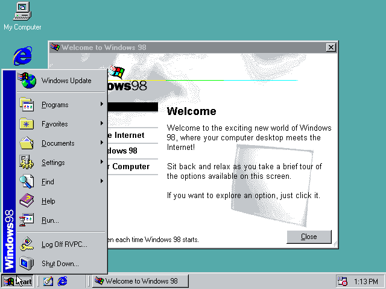
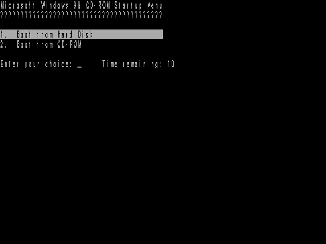
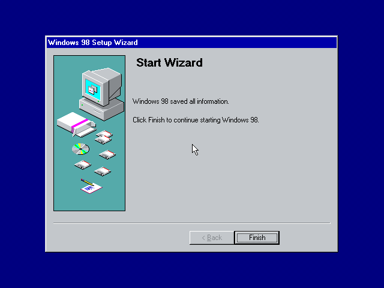
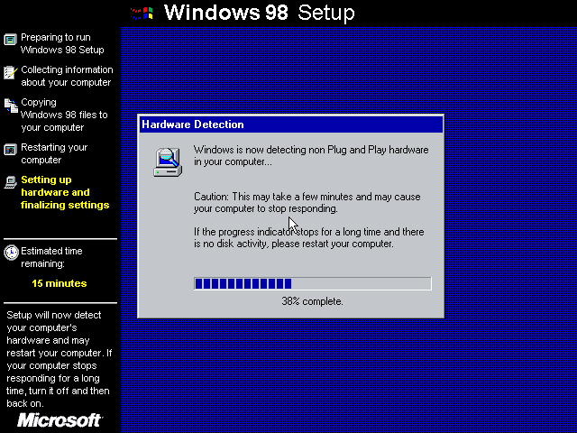
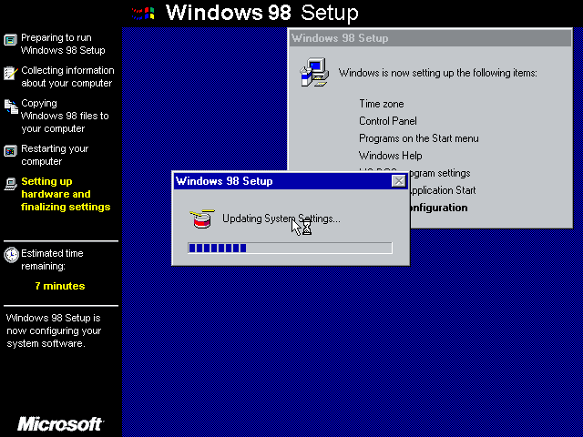

# RVPC — a Windows 98 PC emulator written in Luau

[](https://github.com/claykrs/RVPC/actions/workflows/ci.yml)


**A full 486-class PC — CPU, chipset, disks, VGA, FPU — emulated in Luau, the
scripting language of Roblox. It boots real SeaBIOS firmware and installs
Windows 98 SE from the original CD.**



No host hypervisor, no native code, no DOS shortcuts: every instruction Windows
runs is decoded and executed by a Luau interpreter. The same machine runs
headless under [Lune](https://lune-org.github.io/docs) for testing and
interactively inside Roblox Studio.

## What it can do today

- Boots **SeaBIOS** (the firmware QEMU uses) and its boot menu, from CD,
  floppy or hard disk.
- Installs **FreeDOS 1.3** from CD onto a persistent virtual hard disk.
- Runs **Windows 98 SE Setup** from the retail CD:
  the setup wizard, product key, ~40B instructions of CAB file copying, the
  reboot into the real Windows 98 kernel, hardware detection, Plug and Play
  device setup and the final "setting up the following items" stage.
- Windows 98 boots its protected-mode VxD kernel (VMM32), the 32-bit IDE
  driver (ESDI_506), the boot logo in unchained "mode X" VGA, and the
  640×480 16-colour GUI.
- Windows 98 reaches its **desktop**: Explorer, the taskbar and a working
  **Start menu**, Quick Launch, the tray clock and the "Welcome to Windows 98"
  screen, driven with the emulated **PS/2 mouse**.

See [status](#status) for what is left.

| | |
| --- | --- |
|  |  |
| *SeaBIOS boots the Win98 SE CD (El Torito)* | *First-boot Setup Wizard in the real Win98 GUI* |
|  |  |
| *Non-Plug-and-Play hardware detection* | *Setup's last stage: "Updating System Settings"* |

## The machine

| Component | Emulation |
| --- | --- |
| CPU | 486 core: real / protected / virtual-8086 modes, paging + TLB, task switches, call gates, privilege checks, precise fault restart |
| FPU | 80-bit x87 (190/190 precision-control vectors), CR0.ET/TS lazy switching |
| Firmware | Real SeaBIOS + VGA BIOS images (QEMU builds), PCI BIOS, CMOS disk types |
| Chipset | Dual 8259 PIC, 8254 PIT, MC146818 RTC (alarm + periodic IRQ8, configurable date), 8237 DMA, i440FX/PIIX3 PCI |
| Storage | IDE/ATAPI with PIO, bus-master DMA and packet commands; floppy controller |
| Video | VGA text, planar 16-colour, mode 13h, unchained mode X, VBE/Bochs SVGA |
| Input / I/O | PS/2 keyboard and mouse (8042), UART, LPT |
| Network / audio | NE2000 Ethernet with a host-side virtual ISP (DHCP/DNS/TCP/HTTP), Sound Blaster 16 |
| Snapshots | Delta checkpoints of the whole machine — resume a multi-hour install in seconds |

## Bugs Windows 98 found

Booting a real OS is the best emulator test there is. A few of the CPU and
hardware bugs Windows 98 Setup turned up, each now covered by a regression
test (full write-ups in the [engineering log](docs/ENGINEERING-LOG.md)):

- **The 8042 could not reboot the PC.** Its `0xFE` command pulses the CPU
  reset line, which is how Windows restarts the machine; RVPC only reset the
  keyboard controller, so Setup's restart never happened.
- **Faulting pushes moved ESP.** Win9x grows thread stacks through guard-page
  faults; a `PUSH` whose store faulted had already decremented ESP, so the
  restarted instruction pushed twice and DLL entry points returned into their
  own PE header.
- **CR0.ET read as 0.** Windows concluded there was no coprocessor and sent
  every FPU instruction to its software emulator, which then failed.
- **Call-gate frames** were built in the wrong order, and gate transfers kept
  the target selector's RPL instead of the new CPL — the Plug and Play
  detection thunks read shifted arguments and hung.
- **Near branches past the CS limit** faulted on the target instead of the
  branch, breaking the VMM's ring-0 callback trick.
- **No disk in CMOS 0x12.** Windows' protected-mode IDE driver only claims a
  legacy-controller disk that CMOS lists, so it refused the disk and blocked
  the BIOS path to it.
- **MOV SS / POP SS interrupt shadow**, **CMPSW/SCASW flag width**, and a
  dozen more in the [engineering log](docs/ENGINEERING-LOG.md).

## Status

| Area | State |
| --- | --- |
| SeaBIOS boot, FreeDOS 1.3 install | ✅ working |
| Win98 SE Setup: wizard, file copy, first reboot, hardware detection | ✅ working |
| Win98 kernel boot (VMM32, VxDs, ESDI_506, GUI) | ✅ working |
| Win98 Setup final stage | ✅ completes; the IE4 shell registration (RunOnceEx) failed on builds before the XLAT fix and was replayed from SYSTEM.1ST (see the engineering log) |
| Reboot through the keyboard controller | ✅ working |
| Windows' own shutdown | ✅ the stall was REBOOT's fallback after the old KBC reset bug; the restart now reboots |
| First boot after Setup | ✅ RunOnce steps, hardware wizards, Active Setup |
| Windows 98 desktop | ✅ Explorer, taskbar, Start menu, Quick Launch, Welcome screen |
| Windows 98 mouse | ✅ PS/2 mouse detected and installed; pointer and clicks work |
| Speed | ~0.5M guest instructions/s headless — a full install is many hours |

## Quick start

**Headless (Lune)**

```sh
lune run tools/check.lua                     # the CI gate: format, lint, types, 2000+ assertions
lune run tools/harness.lua                   # boot SeaBIOS headless and watch the screen
lune run tools/win98_run.lua --steps 4000 --save tools/out/w98.snap --save-every 200
lune run tools/win98_run.lua --load tools/out/w98.snap.<N>m   # resume from a checkpoint
```

`tools/win98_run.lua` is also the debugging workbench: instruction/jump
rings, fault and port logs, memory watches, API call tracing, screenshot
export and disk-image export (see the option comments in the file).

**In Roblox Studio**

```sh
lune run tools/build_rbxmx.lua               # writes the importable Rvpc.rbxmx
```

Import `Rvpc.rbxmx` into a place and press Play. The shell presents the VGA
frame through an `EditableImage` and bridges keyboard and mouse input.

## Firmware and media (not included)

The emulator needs real firmware and OS media, which stay out of git.

```powershell
New-Item -ItemType Directory -Force roms
Invoke-WebRequest https://raw.githubusercontent.com/qemu/qemu/master/pc-bios/bios-256k.bin -OutFile roms/bios-256k.bin
Invoke-WebRequest https://raw.githubusercontent.com/qemu/qemu/master/pc-bios/vgabios-stdvga.bin -OutFile roms/vgabios-stdvga.bin
```

Put guest media under `media/` (`win98se.iso` for Windows 98 SE — you need
your own licensed copy and product key; `freedos-boot.iso` and the FreeDOS
floppy set for FreeDOS). The hard-disk image is created on first run.

## Layout

```
core/     Machine, Cpu (486), Fpu, Memory, Vga, Ide, Pic, Pit, Cmos, Kbc,
          Dma, Fdc, Sb16, Ne2000, Isp, Uart, Lpt, Xms, Snapshot
roblox/   Studio shell: EditableImage presenter, input bridge, UI
tests/    23 suites, 2000+ assertions, run by CI on every push
tools/    build, CI gate, Win98 run/debug workbench
docs/     architecture, Windows 98 notes, engineering log, milestone reports
```

The core is environment-pure (`--!strict`, no Roblox or filesystem APIs);
host services — video, input, disks, network, audio — are injected through
`Machine.new`. About 39k lines of Luau: 20k core, 13k tests, 4k tools.

## License

MIT for the emulator source — see [LICENSE](LICENSE). SeaBIOS/VGA BIOS
firmware and guest operating systems are not included.
